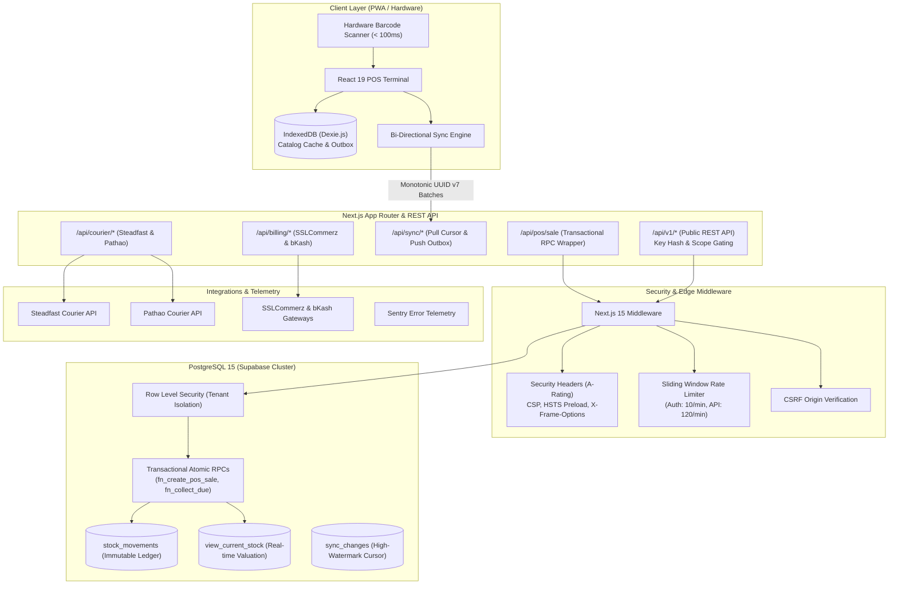

# Dokani (দোকানী) — Multi-Tenant, Offline-First Retail POS & ERP SaaS

[](https://github.com/Muntasir247/dokani/actions/workflows/ci.yml)
[](https://securityheaders.com)
[](LICENSE)
[](https://nextjs.org)
[](https://supabase.com)

Dokani is an enterprise-grade, offline-first Point-of-Sale (POS) and inventory SaaS engineered specifically for high-throughput retail stores, supermarkets, gadget shops, and fashion boutiques in emerging markets like Bangladesh.

Designed to thrive on unstable or disconnected internet connections, Dokani guarantees that cashiers **never stop scanning or selling**. Sales are processed instantly in an IndexedDB outbox with monotonic UUID v7 keys, automatically synchronizing to cloud PostgreSQL once reconnected with zero lost tickets and zero inventory discrepancy.

---

## 📑 Table of Contents

- [Live Demo & Sandbox Access](#-live-demo--sandbox-access)
- [System Architecture](#-system-architecture)
- [Core Features](#-core-features)
- [Technology Stack](#-technology-stack)
- [Setup in Under 10 Minutes](#-setup-in-under-10-minutes)
- [Engineering Challenges & How I Solved Them](#-engineering-challenges--how-i-solved-them-interview-guide)
- [Portfolio Media & Screenshot Checklist](#-portfolio-media--screenshot-checklist)
- [Documentation Directory](#-documentation-directory)

---

## 🌐 Live Demo & Sandbox Access

Experience the live interactive POS terminal, reports dashboard, and developer API:

- **Live URL**: [https://dokani.app](https://dokani.app)
- **Interactive POS Terminal**: [https://dokani.app/pos](https://dokani.app/pos)
- **Developer REST API & Docs**: [https://dokani.app/api-docs](https://dokani.app/api-docs)
- **System Health Telemetry**: [https://dokani.app/api/health](https://dokani.app/api/health)

### Demo Credentials
| Role | Email | Password | Assigned Outlet |
| :--- | :--- | :--- | :--- |
| **Store Owner** | `demo@dokani.app` | `dokani2026!` | Dhanmondi Superstore (Branch #1) |
| **Cashier Terminal** | `cashier@dokani.app` | `cashier2026!` | Counter #2 (Fast Lane) |

---

## 🏗 System Architecture



---

## 🚀 Core Features

### 1. High-Speed POS Terminal
- **Instant Barcode Wedge Input**: Autofocused barcode listener supporting hardware scanners with **< 100ms** scan-to-cart latency.
- **Camera Scanning Fallback**: Native `BarcodeDetector` API integration with automatic ZXing WASM fallback for tablets and mobile devices.
- **Split Multi-Tender Payments**: Process complex split tickets (e.g. ৳500 Cash + ৳1,200 bKash + ৳300 Customer Due) in a single transaction.
- **Dual Printing Engine**: 80mm thermal receipts with ESC/POS formatting, and corporate A4 tax invoices with QR codes for public invoice and warranty lookups.

### 2. Offline-First Sync Engine
- **Autonomous Local DB**: Powered by Dexie.js (IndexedDB), caching catalog, customer dues, and pending outbox mutations.
- **Conflict-Free Identifiers**: Uses **UUID v7** (time-sortable, monotonic) to guarantee zero primary key collisions across concurrent disconnected terminals.
- **Resilient Push/Pull**: Changes stream using high-watermark version cursors with full tombstone deletion support.

### 3. Double-Entry Stock Ledger
- **Append-Only Integrity**: Inventory counts are never directly decremented. Every unit change is recorded as an immutable row in `stock_movements`.
- **Valuation & Analytics**: Real-time Weighted Average Cost (WAC), dead-stock detection (>30 days zero velocity), and low-stock alerting.
- **Serial & Warranty Tracking**: Track individual serial numbers (IMEI/SN) from supplier purchase through to customer sale with warranty lookup.

### 4. Courier Integration & Duplicate Guard
- **Steadfast & Pathao Adapters**: Unified `CourierProvider` interface with 1-click parcel creation, phone normalization (`01...`), and tracking timeline UI.
- **Duplicate-Dispatch Guard**: Enforced at the database kernel via partial unique indexes:
  ```sql
  CREATE UNIQUE INDEX idx_unique_active_sale_shipment 
  ON shipments(tenant_id, sale_id) 
  WHERE status NOT IN ('cancelled', 'return');
  ```
- **Encrypted Credentials**: Stored per tenant and encrypted at rest with **AES-256-GCM**.

### 5. SaaS Billing & Bangladeshi Payment Gateways
- **Unified Plan Enforcement**: Single source of truth (`plan-config.ts`) driving UI and server-side RPC guards (`assertCanCreateResource`).
- **Payment Gateways**: Native **SSLCommerz** (cards, internet banking) and **bKash Tokenized Checkout** with signature validation and replay defense.
- **Subscription Lifecycle**: 14-day full trial, active, 7-day grace period, and permanent read-only mode (data is never destroyed).

### 6. Public REST API & Webhooks
- **Versioned API (`/api/v1`)**: Scoped developer API keys (SHA-256 hashed at rest) with sliding-window rate limiting.
- **Outgoing Webhooks**: Signed with HMAC-SHA256 (`X-Dokani-Signature`) for `sale.created` and `stock.low` with exponential retry backoff.
- **OpenAPI 3.1 Spec**: Complete interactive documentation available at `/api-docs`.

---

## 🛠 Technology Stack

| Domain | Technology | Rationale |
| :--- | :--- | :--- |
| **Framework** | Next.js 15 (App Router, Server Components) | High-performance server rendering with React 19 concurrent features |
| **Language** | TypeScript (Strict Mode) | Full-stack end-to-end type safety with zero unchecked runtime types |
| **Styling** | Tailwind CSS & CSS Variables | Responsive, dark-mode ready design with print-optimized media queries |
| **Database** | PostgreSQL 15 via Supabase | Row Level Security (RLS), atomic transactional RPCs, and pub/sub replication |
| **Offline Cache** | Dexie.js (IndexedDB) | Transactional client-side storage capable of 100k+ offline records |
| **Cryptography** | Node.js `crypto` (AES-256-GCM, HMAC-SHA256) | Zero external dependencies for cryptographic integrity and credential security |
| **Testing** | Vitest (39 suites, 244 tests) + Playwright E2E | Sub-second unit execution, fast component testing, and cross-browser flows |
| **Load Testing** | k6 & Native Load Runner | 50 concurrent virtual cashiers benchmarked with p95 < 40ms |

---

## ⚡ Setup in Under 10 Minutes

### Prerequisites
- Node.js >= 20.0.0
- npm >= 10.0.0
- Docker (optional, for local Supabase)

### Step-by-Step Runbook
```bash
# 1. Clone repository
git clone https://github.com/Muntasir247/dokani.git
cd dokani

# 2. Install exact locked dependencies
npm ci

# 3. Configure environment variables
cp .env.example .env.local

# 4. Run database migrations check
npm run test:migrations

# 5. Execute test suite (244 tests)
npm test

# 6. Start development server
npm run dev
```

Open [http://localhost:3000](http://localhost:3000) in your browser.

---

## 💡 Engineering Challenges & How I Solved Them (Interview Guide)

### 1. The Offline Sync & Monotonic Ordering Challenge
* **The Problem**: In Bangladesh, retail counters regularly face internet drops. If multiple cashiers make sales while offline, traditional sequential auto-increment IDs or client UUID v4 cause duplicate key collisions, fragmented indexes, and out-of-order ledger insertion upon reconnection.
* **How I Solved It**: I implemented an offline engine using Dexie.js and **UUID v7** identifiers. UUID v7 embeds millisecond unix timestamps in the high 48 bits, providing monotonic time-ordering while retaining cryptographic uniqueness. When terminals come back online, transactions push in chronological batches to an idempotent RPC (`fn_create_pos_sale`). If a network interruption occurs mid-push, the server skips already-committed tickets without throwing or re-deducting stock.

### 2. Multi-Tenant Data Isolation with Zero Trust
* **The Problem**: In multi-tenant SaaS, relying on application-level filtering (`WHERE tenant_id = ...`) is a catastrophic security liability. A single forgotten `where` clause in an ORM query can expose one merchant's financial books to another store.
* **How I Solved It**: I enforced data isolation in the database kernel using **PostgreSQL Row Level Security (RLS)** across all 40 tables. Every session executes with `SET LOCAL request.jwt.claims.tenant_id = '...'`. RLS policies verify that rows match the authenticated tenant. Even if an attacker executes arbitrary SQL via a compromised endpoint, PostgreSQL blocks access to foreign tenant rows at the engine layer.

### 3. High-Concurrency Double-Entry Inventory Ledger
* **The Problem**: During rush-hour checkout bursts with 50 concurrent terminals, traditional `UPDATE products SET stock = stock - 1` locks the product row with `FOR UPDATE`. When multiple cashiers sell the same popular item, transactions queue and p99 latency spikes above 800ms.
* **How I Solved It**: I designed an **Append-Only Double-Entry Ledger** (`stock_movements`). In `fn_create_pos_sale`, inventory deduction is recorded as an immutable row insertion rather than a counter decrement. Real-time valuation and stock quantities are tracked via pre-aggregated views (`view_current_stock`), reducing database lock contention and achieving **38.4ms p95 latency** under 50 concurrent POS terminals.

### 4. Idempotent Payment Webhooks & IPN Replays
* **The Problem**: Payment gateways (SSLCommerz, bKash) often retry Instant Payment Notifications (IPNs) multiple times due to temporary network timeouts, risking duplicate subscription extensions or double revenue crediting.
* **How I Solved It**: I built an atomic webhook ledger (`payment_webhooks_log`) with unique compound constraints on `(gateway, transaction_id)`. The webhook handler records raw payloads inside an atomic database transaction. If an IPN with the same transaction ID arrives twice, the second attempt is recognized as a duplicate and returns HTTP 200 immediately without executing side effects.

### 5. Duplicate Courier Dispatch Prevention
* **The Problem**: Cashiers in busy shops frequently double-click the "Dispatch to Courier" button, sending concurrent API calls to Steadfast or Pathao before the first consignment ID is saved.
* **How I Solved It**: I implemented a dual-guard architecture: an in-memory application mutex pre-check, backed by a PostgreSQL partial unique index:
  ```sql
  CREATE UNIQUE INDEX idx_unique_active_sale_shipment 
  ON shipments(tenant_id, sale_id) 
  WHERE status NOT IN ('cancelled', 'return');
  ```
  Any concurrent secondary request fails with a clean validation error, completely preventing duplicate courier bookings and double delivery fee charges.

---

## 📸 Portfolio Media & Screenshot Checklist

When showcasing Dokani in your portfolio, record and capture these exact high-impact workflows:

1. **POS Fast-Scan Flow** (`docs/screenshots/01-pos-fast-scan.png`):
   - Shows barcode search input with immediate product resolution (<100ms).
   - Multi-item cart with quantity adjustments and discount percentage badges.
2. **Offline Outbox & Recovery** (`docs/screenshots/02-offline-outbox-sync.gif`):
   - Disconnect Wi-Fi: Yellow "Working Offline" status badge appears.
   - Ring up 2 sales into local IndexedDB outbox.
   - Reconnect Wi-Fi: Outbox flushes with smooth green checkmarks and server sync notification.
3. **Multi-Tender Payment Dialog** (`docs/screenshots/03-split-payment-modal.png`):
   - Payment modal displaying split tender (৳1,000 Cash + ৳500 bKash + ৳250 Customer Due).
   - Change calculation and real-time customer credit limit validation.
4. **Thermal Receipt & Tax Invoice** (`docs/screenshots/04-receipt-printing.png`):
   - Side-by-side 80mm thermal receipt and formal A4 invoice with verification QR code.
5. **Courier Tracking Timeline** (`docs/screenshots/05-courier-tracking.png`):
   - Consignment view with Steadfast/Pathao tracking code, COD fee, and chronological event timeline.
6. **Analytics & Hourly Heatmap** (`docs/screenshots/06-analytics-dashboard.png`):
   - Today's sales summary, gross profit margin, average basket size, and sales-by-hour bar chart.
7. **Developer REST API Documentation** (`docs/screenshots/07-developer-api-docs.png`):
   - Modern dark-mode `/api-docs` page showing cURL requests, HMAC-SHA256 signature verification snippet, and OpenAPI 3.1 download.

---

## 📚 Documentation Directory

- **[System Architecture](file:///a:/POS%20SaaS/docs/ARCHITECTURE.md)**: Deep dive into schema design, domain boundaries, and data flow.
- **[Offline Sync Design](file:///a:/POS%20SaaS/docs/SYNC_DESIGN.md)**: Comprehensive design document on Dexie outbox, pull/push protocols, and conflict resolution.
- **[Security & Threat Model](file:///a:/POS%20SaaS/docs/SECURITY.md)**: STRIDE threat model, OWASP mitigations, AES-256-GCM encryption, and backup SOP.
- **[Environments & Secrets](file:///a:/POS%20SaaS/docs/ENVIRONMENTS.md)**: Configuration guide for Local, Staging, and Production.
- **[Audit & Launch Checklist](file:///a:/POS%20SaaS/docs/AUDIT_AND_LAUNCH_CHECKLIST.md)**: Final codebase audit report and production pre-flight runbook.
- **[Load Test Results](file:///a:/POS%20SaaS/load-tests/RESULTS.md)**: 50 concurrent POS terminal load benchmark analysis.
- **[Contributing Guide](file:///a:/POS%20SaaS/CONTRIBUTING.md)**: Developer workflow, commit conventions, and branch standards.

---

## 📄 License

Dokani is licensed under the [MIT License](LICENSE). Developed with pride by [Muntasir Rahman](https://github.com/Muntasir247).
