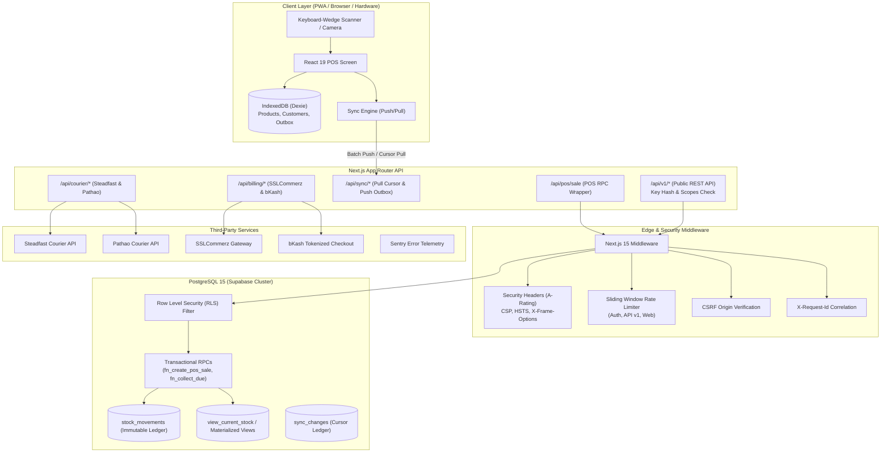

# Dokani POS SaaS System Architecture

## 1. Architectural Philosophy

Dokani is engineered as a **mission-critical retail operating system** tailored to emerging markets like Bangladesh where network instability is frequent, but fast customer checkout cannot halt. The platform adheres to five foundational tenets:

1. **Zero-Trust Multi-Tenancy**: Data isolation is enforced in the database kernel using PostgreSQL Row Level Security (RLS). Application bugs cannot leak records between stores.
2. **Offline-First Resilience**: The client-side POS terminal functions autonomously using IndexedDB (Dexie). The cash register never blocks waiting on cloud latency.
3. **Double-Entry Append-Only Inventory**: Stock is never mutated via direct numeric decrements; all changes are immutable `stock_movements` that maintain an unalterable audit trail.
4. **Strict Idempotency**: All mutations (sales, sync pushes, billing IPNs, courier bookings) require unique idempotency keys to guarantee at-most-once execution.
5. **Separation of Concerns**: Micro-modular domain layout separating catalog, inventory, POS, billing, couriers, and observability into decoupled services.

---

## 2. End-to-End System Architecture

---

## 3. Database Domain Models & Core Schemas

### A. Tenant Isolation & Membership
- `tenants`: Primary enterprise account with currency (`BDT`), timezone (`Asia/Dhaka`), deletion schedule.
- `tenant_members`: User assignments (`owner`, `manager`, `cashier`) with granular RBAC permissions.
- `stores`: Physical locations / branch outlets belonging to a tenant.

### B. Catalog & Double-Entry Inventory
- `products`: Parent product definitions (name, category, warranty months, serial tracking flag).
- `product_variants`: Stock-keeping units (SKU, barcode, cost price, retail price, reorder point).
- `stock_movements`: Immutable ledger recording every quantity change with type (`purchase`, `sale`, `return`, `adjustment`, `transfer`), unit cost, and reference.
- `product_serials`: Individual tracked serial numbers (IMEI / serial number) for electronics warranty lookup.

### C. POS Sales & Payment Split
- `sales`: Finished tickets with subtotal, discount, tax, total, paid, and outstanding due.
- `sale_items`: Snapshot of items sold with unit price and cost basis at time of sale.
- `sale_payments`: Multi-tender split records (Cash, bKash, Nagad, Card, Due).
- `cash_drawer_sessions`: Cashier shift tracking with opening float, expected vs counted cash, and variance.

### D. Couriers & Public REST API
- `tenant_courier_configs`: Per-tenant API keys encrypted at rest via AES-256-GCM.
- `shipments`: Parcels booked with Steadfast/Pathao with duplicate-dispatch partial unique index.
- `tenant_api_keys`: Developer API keys hashed at rest via SHA-256 with granular scopes.
- `webhook_deliveries`: Audit history of outgoing signed HMAC-SHA256 webhook deliveries.

---

## 4. Offline Synchronization Engine

Detailed in [SYNC_DESIGN.md](file:///a:/POS%20SaaS/docs/SYNC_DESIGN.md):
- **Local Storage**: IndexedDB accessed via Dexie.js holding catalog, customers, and `outbox_mutations`.
- **Client Identifiers**: Uses UUID v7 (monotonic, timestamp-ordered) to eliminate ID collisions between offline terminals.
- **Push Synchronization**: Queued outbox mutations are sent in transactional batches with idempotency keys. If the server already processed a transaction, it returns the existing record idempotently.
- **Pull Synchronization**: Client tracks high-watermark `cursor`. Server streams changes from `sync_changes` table, including soft deletions (tombstones).

---

## 5. Security Architecture & Threat Model

Detailed in [SECURITY.md](file:///a:/POS%20SaaS/docs/SECURITY.md):
- **A-Grade Security Headers**: Strict CSP, HSTS 2-year preload, `X-Frame-Options: DENY`, `X-Content-Type-Options: nosniff`.
- **Zero-PII Logging**: Automated redaction filter replaces customer phone numbers, emails, passwords, and API keys with `[REDACTED]`.
- **AES-256-GCM Cryptography**: Encrypts all stored courier credentials at rest using 128-bit authentication tags.
