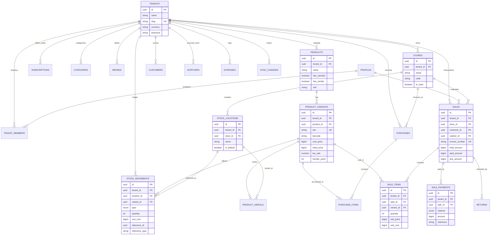

# Dokani - System Architecture & Database Design

This document details the core database architecture, multi-tenancy model, and ledger-based inventory system powering **Dokani**, an offline-first Point-of-Sale SaaS tailored for retail businesses in Bangladesh.

---

## 1. Entity-Relationship Diagram (ERD)

---

## 2. Multi-Tenancy Architecture

### 2.1 Shared-Database, Row-Partitioned Model
Dokani operates on a single Postgres database with tenant isolation enforced strictly at the row level:
- **`tenant_id` on Every Table**: Every tenant-owned table explicitly includes a non-null `tenant_id UUID REFERENCES tenants(id) ON DELETE CASCADE`.
- **Composite Indexing**: High-cardinality queries always feature `tenant_id` as the leading column in composite indexes (e.g. `(tenant_id, barcode)`, `(tenant_id, sku)`, `(tenant_id, sold_at DESC)`).
- **Tenant Context**: In application requests, user identity is mapped to tenant membership via `tenant_members(tenant_id, user_id)`. RLS policies in Step 2 enforce that no query can bypass `tenant_id = auth.current_tenant_id()`. Client-side filters are never trusted for tenant isolation.

### 2.2 Soft Deletion & Audit Trail
- Every tenant table contains `deleted_at TIMESTAMPTZ`, allowing safe undo operations, historic audit reports, and clean tombstones during offline synchronization.
- Sensitive state changes are logged to `audit_logs` capturing `actor_id`, `old_values`, and `new_values`.

---

## 3. Inventory as an Append-Only Ledger

### 3.1 Why Not a Mutable `quantity` Column?
Traditional POS systems that execute `UPDATE products SET stock = stock - 1` suffer from:
1. **Lost Updates & Race Conditions**: Two cashiers selling the same item offline or concurrently create inconsistent counts.
2. **Zero Auditability**: If the stock count is wrong, it is impossible to determine whether the cause was theft, missed deliveries, unrecorded returns, or software bugs.
3. **Complex Sync Merges**: Merging conflicting scalar numbers across offline clients is prone to silent inventory loss.

### 3.2 Dokani's Ledger Engine (`stock_movements`)
In Dokani, current stock is **never a raw mutable column**. It is always dynamically derived from the immutable `stock_movements` table:
$$\text{Current Stock} = \sum_{\text{movements}} \text{quantity}$$

#### Movement Types:
- `purchase`: $+Q$ (Inbound stock from supplier invoices)
- `sale`: $-Q$ (Outbound stock decremented upon invoice completion)
- `return`: $+Q$ (Customer returns item back to stock)
- `adjustment`: $\pm Q$ (Physical inventory audit adjustments with audit notes)
- `transfer_in`: $+Q$ (Inter-store stock arrival)
- `transfer_out`: $-Q$ (Inter-store stock dispatch)

#### Performance Optimization (`view_current_stock`):
- Aggregates are computed via indexed groupings on `(tenant_id, location_id, variant_id)`.
- Materialized views or cached snapshot ledgers can be triggered periodically for high-volume stores without compromising the single source of truth.

---

## 4. Financial Calculations: Minor Units (Poisha)

All monetary values (`cost_price`, `retail_price`, `wholesale_price`, `subtotal`, `tax_amount`, `paid_amount`, `due_amount`, `credit_limit`) are stored strictly as **64-bit BigInt integer minor units** (1 BDT = 100 Poisha).
- Floating-point representations (`float`, `double`) are banned to eliminate rounding drift (`0.1 + 0.2 !== 0.3`).
- Display formatting (`৳1,650.00`) is handled in presentation layers using standard `Intl.NumberFormat` localized for Bangladesh.

---

## 5. Offline Sync Primitives

1. **`sync_changes` Table**: An append-only delta journal capturing `(tenant_id, table_name, record_id, op, record_version, updated_at)`. When an offline POS client reconnects, it queries `sync_changes` where `updated_at > last_sync_time`.
2. **`idempotency_keys` Table**: Prevents double-billing or duplicate stock movements when weak mobile networks cause retransmitted POS transactions.
3. **Monotonic `version` Counters**: Every row increments its `version` integer on update, enabling deterministic Last-Write-Wins (LWW) or conflict detection.
