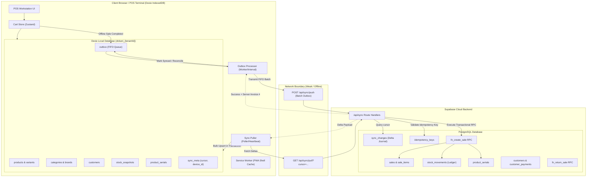
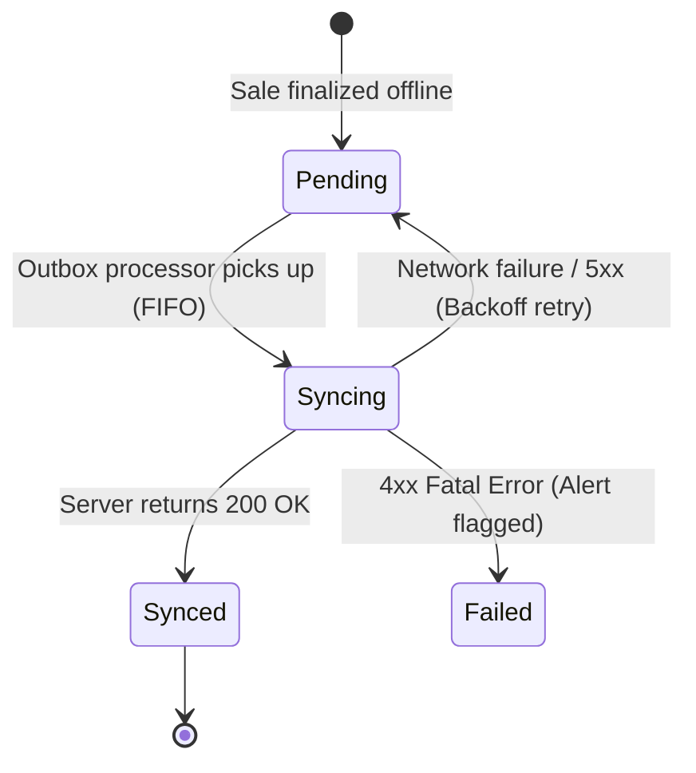

# Dokani POS: Offline-First Synchronization & Resilience Architecture
**Document**: `docs/SYNC_DESIGN.md`  
**Status**: DRAFT (Pending User Review & Approval)  
**Author**: Antigravity AI & Dokani Core Engineering Team  
**Date**: 2026-10-22  
**Target Release**: Step 5 (Offline POS & Safe Two-Way Sync)

---

## 1. Executive Summary & Core Principles

Dokani (দোকানী) is built specifically for retail and wholesale merchants in Bangladesh (electronics, gadgets, groceries, fashion). In this market, physical connectivity is fundamentally unreliable:
* **Load shedding**: Frequent 1–3 hour rolling power outages disconnect Wi-Fi routers.
* **Flaky mobile cellular networks**: 4G/3G mobile hotspot connections experience packet loss, intermittent disconnects, and high latency spikes.
* **High-velocity checkout counters**: During evening rush hours, cashiers cannot tolerate a spinner or blocked checkout UI waiting on a cloud round-trip.

### The Immutable Real-World Law of Retail
> **If money and goods changed hands at the physical checkout counter, the sale has already happened in the real world.**  
> The software must record and honor that physical reality. A point-of-sale system that fails, crashes, rolls back, or rejects a sale because the cloud is unreachable or the cloud database reports zero stock is broken by definition.

### Guiding Principles
1. **Local-First Speed (< 100ms)**: Adding items, editing quantities, selecting serial numbers, and checking out must occur entirely against local browser storage (IndexedDB) with zero synchronous cloud dependencies.
2. **Deterministic Append-Only Outbox**: All mutations (sales, customer creations, returns) are written to a durable local outbox table before any network transmission is attempted.
3. **Strict Idempotency**: Every push mutation carries a client-generated UUID v7 and a cryptographically distinct idempotency key. Network replays, retries, and timeouts can never produce duplicate sales, payments, or ledger entries.
4. **Zero Silent Data Loss**: If an offline sale oversells stock (e.g., another device sold the same physical item), the sale is accepted by the server, the inventory ledger reflects the negative movement, and an immediate negative-stock alert is raised for management audit.
5. **Clean Partitioning & Security**: Local storage is isolated strictly by `tenant_id` and `user_id`. When a cashier logs out, active connections are closed and local cache data is cleared.

---

## 2. System Architecture & Two-Way Data Flow

The sync architecture separates reads (**Pull Sync**) from writes (**Push Sync**) into two distinct unidirectional flows.



---

## 3. Local Storage Schema (Dexie IndexedDB)

Local storage is managed via **Dexie.js**, providing robust indexed access, transaction support, and cross-browser stability.

### 3.1 Database Isolation & Multi-Tenancy
The database is partitioned per tenant using the name:
```ts
const dbName = `dokani_${tenantId}`;
```
Switching tenants or logging out closes the current database instance, completely preventing cross-tenant data leakage.

### 3.2 Dexie Table Definitions
```ts
export class DokaniOfflineDB extends Dexie {
  products!: Table<LocalProduct, string>;
  variants!: Table<LocalVariant, string>;
  categories!: Table<LocalCategory, string>;
  brands!: Table<LocalBrand, string>;
  customers!: Table<LocalCustomer, string>;
  stock_snapshots!: Table<LocalStockSnapshot, string>; // key: variant_id
  serials!: Table<LocalSerial, string>;
  outbox!: Table<OutboxEntry, string>; // key: id (UUID v7)
  sync_meta!: Table<SyncMetaEntry, string>; // key: key

  constructor(tenantId: string) {
    super(`dokani_${tenantId}`);
    
    this.version(1).stores({
      products: "id, tenant_id, category_id, brand_id, name, updated_at",
      variants: "id, product_id, sku, barcode, retail_price, updated_at",
      categories: "id, tenant_id, name",
      brands: "id, tenant_id, name",
      customers: "id, tenant_id, phone, name, updated_at",
      stock_snapshots: "variant_id, store_id, location_id, updated_at",
      serials: "id, variant_id, serial_number, status, updated_at",
      outbox: "id, tenant_id, mutation_type, status, created_at, [tenant_id+status]",
      sync_meta: "key",
    });
  }
}
```

### 3.3 What is Cached Locally vs What is Left Server-Only

| Entity | Cached in IndexedDB? | Rationale |
| :--- | :--- | :--- |
| **Products & Variants** | **YES** (full catalog) | Required for instant barcode scanning, text search, and tile browsing without network. |
| **Retail Prices & Tax** | **YES** | Point-of-sale checkout requires instant local price computation. |
| **Supplier Cost Prices** | **NO** (for cashiers) | Preserves merchant cost privacy on local POS tablets. Only owners/managers cache costs. |
| **Categories & Brands** | **YES** | Required for category pill filtering and catalog navigation. |
| **Active Customers** | **YES** (name, phone, due) | Required for customer search, phone lookup, and credit limit checks at checkout. |
| **Stock Snapshots** | **YES** (current balance) | Provides estimated stock on hand on tiles; decremented locally as sales happen. |
| **Product Serials** | **YES** (`status = 'available'`) | Required for gadget/electronics serial selection and barcode scan validation. |
| **Historical Sales / Receipts** | **NO** (only today's / recent 50) | Historical data is large and unneeded for fast checkout; saves local disk storage. |
| **Supplier Orders / Stock Movements** | **NO** | Back-office functions that require administrative connectivity. |

---

## 4. Pull Synchronization Protocol (Server -> Client)

Pull sync brings down catalog changes, price updates, newly added serials, and updated customer balances to the POS tablet.

### 4.1 Cursor Mechanism
The server's `sync_changes` table records every database delta:
```sql
CREATE TABLE sync_changes (
    id UUID PRIMARY KEY DEFAULT gen_random_uuid(),
    tenant_id UUID NOT NULL REFERENCES tenants(id) ON DELETE CASCADE,
    table_name VARCHAR(100) NOT NULL,
    record_id UUID NOT NULL,
    op sync_op NOT NULL, -- 'INSERT' | 'UPDATE' | 'DELETE'
    record_version BIGINT NOT NULL,
    updated_at TIMESTAMPTZ NOT NULL DEFAULT now()
);
```
The client stores a high-water mark cursor:
`last_pulled_cursor`: ISO timestamp `updated_at` (with sub-millisecond precision) of the latest applied delta.

### 4.2 Pull Endpoint Contract (`GET /api/sync/pull`)
* **Request**:
  ```http
  GET /api/sync/pull?tenantId=...&storeId=...&cursor=2026-10-22T01:30:00.123Z&limit=500
  ```
* **Response**:
  ```json
  {
    "hasMore": false,
    "nextCursor": "2026-10-22T02:15:45.981Z",
    "changes": {
      "products": { "upserts": [...], "deletes": ["uuid-1"] },
      "variants": { "upserts": [...], "deletes": [] },
      "categories": { "upserts": [...], "deletes": [] },
      "customers": { "upserts": [...], "deletes": [] },
      "stock_snapshots": { "upserts": [...], "deletes": [] },
      "serials": { "upserts": [...], "deletes": ["uuid-sold-serial"] }
    }
  }
  ```

### 4.3 Initial Full Sync & Resumability
* **First Launch (Cold Start)**: The cursor is null. The server serves the active dataset in batched chunks (500 items per page).
* **Progress Reporting**: The UI displays a progress bar (`Syncing catalog: 35%... 70%... Complete`).
* **Resumability**: If the Wi-Fi cuts out at page 2 of 5, the client saves `last_pulled_cursor` from page 2. On reconnection, it resumes from page 2 rather than restarting from zero.
* **Atomic Batch Application**: Each chunk is applied inside a single Dexie transaction:
  ```ts
  await db.transaction('rw', [db.products, db.variants, db.sync_meta], async () => {
    await db.products.bulkPut(changes.products.upserts);
    await db.products.bulkDelete(changes.products.deletes);
    await db.sync_meta.put({ key: 'last_pulled_cursor', value: nextCursor });
  });
  ```

---

## 5. Push Synchronization Protocol (Client -> Server: Outbox Engine)

The Outbox pattern guarantees that offline sales are never lost, even if the browser crashes, the device restarts, or the network connection fails.

### 5.1 Outbox Entry Schema
```ts
export interface OutboxEntry {
  id: string; // UUID v7 (time-sortable)
  tenantId: string;
  storeId: string;
  mutationType: "create_sale" | "create_customer" | "return_sale" | "void_sale";
  idempotencyKey: string; // "idemp_{tenantId}_{deviceId}_{id}"
  payload: Record<string, unknown>;
  createdAt: string; // ISO string
  status: "pending" | "syncing" | "synced" | "failed";
  retryCount: number;
  lastAttemptedAt: string | null;
  lastError: string | null;
  serverResult?: Record<string, unknown>;
}
```

### 5.2 Outbox Processing Lifecycle
1. **Creation**: When cashier clicks "Complete Sale (F4)", the sale payload is validated with Zod, an `id` is generated with `uuidv7()`, and the entry is stored in Dexie's `outbox` with status `'pending'`. Local stock snapshots in Dexie are immediately decremented so subsequent scans reflect the reduced stock.
2. **Queue Execution (FIFO)**: The background outbox processor retrieves all entries where `status IN ('pending', 'failed')` ordered by `createdAt ASC`.
3. **In-Flight Locking**: The active entry status is set to `'syncing'`.
4. **Network Push (`POST /api/sync/push`)**: Sends the mutation payload along with the `idempotencyKey`.
5. **Success Handling**: Server returns `200 OK` with the confirmed fiscal invoice number. The outbox entry is updated to `'synced'` and local metadata is updated.
6. **Error Handling & Backoff**:
   * **Network / 5xx Server Errors**: Status reverted to `'pending'`, `retryCount` incremented. Processor pauses using exponential backoff:
     $$\text{delay} = \min(60000, 1000 \times 2^{\text{retryCount}}) \pm 20\% \text{ jitter}$$
   * **4xx Validation / Business Logic Errors**: Status set to `'failed'`. Alert displayed on terminal header for cashier/manager review.



---

## 6. Server-Side Idempotency Mechanics

Network requests can fail after the server has processed the transaction but before the client receives the acknowledgment. Replaying a push must be strictly idempotent.

### 6.1 Database Idempotency Table
```sql
CREATE TABLE idempotency_keys (
    id UUID PRIMARY KEY DEFAULT gen_random_uuid(),
    tenant_id UUID NOT NULL REFERENCES tenants(id) ON DELETE CASCADE,
    key VARCHAR(255) NOT NULL,
    resource_type VARCHAR(50) NOT NULL,
    response_status INTEGER NOT NULL,
    response_payload JSONB,
    created_at TIMESTAMPTZ NOT NULL DEFAULT now(),
    CONSTRAINT uq_idempotency_key_per_tenant UNIQUE (tenant_id, key)
);
```

### 6.2 Transactional Idempotent Wrapper Flow
When `/api/sync/push` receives an outbox item:
1. Begin a Postgres transaction.
2. Check `idempotency_keys` with pessimistic locking:
   ```sql
   SELECT response_status, response_payload 
   FROM idempotency_keys 
   WHERE tenant_id = $1 AND key = $2 
   FOR UPDATE;
   ```
3. **If Found**: Key was already processed. Immediately return the stored `response_status` and `response_payload`. **No sales, stock movements, or invoice numbers are generated again.**
4. **If Not Found**:
   * Execute the business RPC (`fn_create_sale`, `fn_return_sale`, etc.).
   * Insert record into `idempotency_keys`:
     ```sql
     INSERT INTO idempotency_keys (tenant_id, key, resource_type, response_status, response_payload)
     VALUES ($1, $2, 'sale', 201, $result_json);
     ```
   * Commit the transaction and return the result.

---

## 7. Conflict Resolution Policies

### 7.1 Sales Are Append-Only Events (No Conflicts)
Sales represent real-world physical exchanges that have already occurred. In our architecture:
* A sale record created offline is **never overwritten** or rejected due to a conflict with another terminal.
* Each offline terminal creates independent sale rows with unique UUIDs.

### 7.2 Stock Reconciliation & The "Oversold While Offline" Policy
**The Scenario**: Terminal A and Terminal B both have 1 unit of a laptop in local cache. While both are offline, Terminal A sells 1 unit to Customer X, and Terminal B sells 1 unit to Customer Y.

**The Policy**:
1. When Terminal A syncs, it appends a `sale_out` movement of -1 unit. Server stock reaches 0.
2. When Terminal B syncs, the server detects that current stock is 0.
3. **The sale is NOT dropped or rejected.** The sale has already completed; the customer walked out with the laptop.
4. The server records the sale, appends the `sale_out` movement of -1 unit, resulting in a ledger stock balance of **-1**.
5. The server flags an audit alert:
   ```json
   {
     "type": "negative_stock_alert",
     "severity": "high",
     "variantId": "...",
     "saleId": "...",
     "message": "Offline sale caused stock to drop to -1. Physical inventory recount or purchase entry required."
   }
   ```
6. The manager dashboard surfaces an unresolved discrepancy tile requiring management review (e.g. recording an unentered supplier delivery or stock adjustment).

### 7.3 Price Changes & Catalog Edits
* The server catalog operates under **Last-Write-Wins (LWW)** governed by monotonically increasing `version` numbers.
* **Price Snapshot Guarantee**: Every sale item captures the exact `unit_price_poisha` at the time of checkout. If an admin changes a product's price from ৳500 to ৳600 while an offline terminal is selling it at ৳500, the sale records ৳500. The merchant collected ৳500 in cash; retroactively changing the price would corrupt financial accounting.

### 7.4 Serial Number Collisions
* If the exact same serial number is sold on two offline devices:
  * Device 1 syncs: Serial marked `sold`, linked to Sale 1.
  * Device 2 syncs: Serial is already marked `sold`. Sale 2 is recorded, but flagged with a high-severity `serial_duplicate_collision` alert linking both sale IDs for physical branch audit.

---

## 8. Offline Invoice Numbering Strategy

In a multi-terminal store, multiple cashiers can generate invoices simultaneously while offline without network coordination.

### 8.1 Dual-Number Architecture
Every sale maintains two invoice identifiers:
1. `offline_invoice_number`: Generated instantly on the client device.
2. `invoice_number`: The official, gapless, sequential fiscal invoice number assigned by the server upon sync.

### 8.2 Offline Invoice Format
```
OFF-{storeCode}-{deviceCode}-{localSeq}
```
* `storeCode`: 4-character outlet code (e.g., `DHK1`).
* `deviceCode`: Unique terminal identifier generated on device registration (e.g., `T01`, `T02`).
* `localSeq`: 6-digit zero-padded monotonic sequence stored in Dexie `sync_meta` (e.g., `000042`).
* Example: `OFF-DHK1-T01-000042`.

### 8.3 Post-Sync Reconciliation
* The offline receipt printed at the time of sale shows `OFF-DHK1-T01-000042`.
* Once synced, the server assigns the official fiscal invoice `INV-202610-000189`.
* Both numbers are indexed in Postgres. Searching for either number returns the exact sale record. Receipts reprinted after sync display both numbers.

---

## 9. PWA Shell, Service Worker & Offline Loading

To ensure the POS loads even with no internet connection at cold boot, Dokani implements a Progressive Web App (PWA) service worker.

### 9.1 Caching Strategies
* **App Shell & Static Assets (JS, CSS, Web Fonts, Images)**:
  * **Cache-First**: Served directly from Cache Storage. Updated in the background via service worker lifecycle `skipWaiting()`.
* **POS Navigation Route (`/pos`)**:
  * **Network-First with Cache Fallback**: Attempts network fetch; if offline or network times out after 1.5s, immediately serves cached `/pos` app shell from Cache Storage.
* **API Routes (`/api/*`)**:
  * **Network-Only**: Never cached by the service worker; handled entirely by Dexie IndexedDB and the Outbox Engine.

### 9.2 Web App Manifest (`manifest.webmanifest`)
```json
{
  "name": "Dokani POS - দোকানী",
  "short_name": "Dokani",
  "start_url": "/pos",
  "display": "standalone",
  "background_color": "#ffffff",
  "theme_color": "#059669",
  "icons": [
    { "src": "/icons/icon-192.png", "sizes": "192x192", "type": "image/png" },
    { "src": "/icons/icon-512.png", "sizes": "512x512", "type": "image/png" }
  ]
}
```

### 9.3 "Install App" UI Prompt
* Intercepts browser `beforeinstallprompt` event.
* Displays a modern banner in the POS header: *"Install Dokani for reliable offline operation"* with an "Install" button.

---

## 10. Security & Threat Model

### 10.1 Local Storage Encryption Rationale
* **Decision**: We do **not** encrypt IndexedDB data using client-derived AES keys.
* **Why**:
  1. Low-cost Android POS tablets and entry-level laptops suffer severe performance degradation deriving keys via PBKDF2/argon2 on every scan.
  2. Web browser sandboxing already guarantees origin isolation: domain-scoped IndexedDB cannot be read by other websites or applications.
  3. If an attacker gains root/physical access to an unencrypted device, RAM scraping or keystroke interception easily bypasses browser-level encryption anyway.

### 10.2 Cache Binding & Logout Sanitization
* The local cache is strictly bound to `activeTenant.id` and `currentUser.id`.
* **On Explicit Logout**:
  * Dexie database connection is closed.
  * All local tables for that tenant (`products`, `customers`, `serials`, `stock_snapshots`) are deleted via `Dexie.delete(dbName)`.
  * **Unsynced Outbox Guard**: If there are pending entries in the outbox, the cashier is blocked with a modal warning: *"You have 3 un-synced sales. Please connect to internet to sync before logging out, or data on this device may be lost."*

### 10.3 Lost or Stolen Device Threat Model
* **Threat**: A POS tablet is stolen from a retail store.
* **Attack Surface**: The thief inspects browser IndexedDB to view customer phone numbers or attempt to push fraudulent offline sales.
* **Mitigation (Device Authorization & Remote Revocation)**:
  1. Every POS installation registers a device entry in `tenant_devices` (`id`, `device_code`, `device_secret_hash`, `is_revoked`).
  2. Every outbox push transmits the device authentication token.
  3. **Remote Revoke**: An owner or manager can click **"Revoke Terminal"** from the admin dashboard.
  4. The server immediately rejects any future push requests from that device with `403 Forbidden: Device Revoked`.
  5. The device's refresh token is invalidated, locking the thief out of the application.

---

## 11. Failure Modes & Edge Case Matrix

| Failure Mode | Root Cause | System Behavior & Recovery |
| :--- | :--- | :--- |
| **Network dies mid-push** | Wi-Fi cuts out during HTTP request transmission | The client request times out. Outbox entry remains `'pending'`. On next connection attempt, request is resent with the **exact same idempotency key**. Server returns existing record if already processed, or processes it once. **Zero duplicates.** |
| **Server process crash** | Server crashes during RPC execution | PostgreSQL rolls back the entire transaction. Idempotency key is not recorded. When client reconnects, it resends; server processes clean transaction. |
| **Duplicate replay attack** | Client accidentally fires push twice in parallel | Handled by `FOR UPDATE` lock on `idempotency_keys` table. First request completes and caches payload; second request waits for lock and receives cached result without duplicate execution. |
| **Device battery death** | Tablet loses power during checkout | Dexie writes are atomic: the sale is either fully committed to local IndexedDB or rolled back. On reboot, if in outbox, it syncs normally. |
| **Simultaneous offline sales of last unit** | Two offline cashiers sell the same last item | Both sales succeed offline. Server accepts both sales upon sync, inventory ledger drops to -1, and a `negative_stock_alert` is raised for manager resolution. |
| **Price edited during offline sale** | Admin changes price while cashier is offline | Sale records the price snapshot captured at the physical moment of checkout. Server respects snapshot price to preserve accounting ledger truth. |
| **Serial number duplicate scan offline** | Two cashiers enter same serial offline | First sync links serial to Sale 1; second sync accepts Sale 2 but flags `serial_duplicate_collision` audit log. |

---

## 12. Trade-Offs & Why Each Decision Was Made

### 1. Dexie (IndexedDB) vs SQLite in WebAssembly
* **Decision**: Dexie over SQLite WASM.
* **Rationale**: SQLite WASM requires massive multi-megabyte binary downloads, SharedArrayBuffer headers (`COOP`/`COEP`) which break third-party payment gateways (bKash/Nagad iframes), and slow cold-boot times. Dexie is lightweight (< 30KB), native to all browsers, and handles hundreds of thousands of records with ease.

### 2. Pull Sync via Delta Journal (`sync_changes`) vs Logical Replication
* **Decision**: Custom `sync_changes` table polled with cursor.
* **Rationale**: Postgres logical replication or WebSockets cannot operate over intermittent, high-latency Bangladesh cellular connections. A stateless HTTP delta-pull endpoint is firewall-friendly, CDN-cacheable, resumable, and extremely resilient to packet loss.

### 3. Acceptance of Negative Stock vs Rejection
* **Decision**: Accept offline sale and record negative stock balance.
* **Rationale**: In real-world retail, the customer has already paid money, received the paper receipt, and exited the store with the product. Rejecting the sale on sync would cause phantom cash in the drawer, unrecorded revenue, missing tax reporting, and severe reconciliation headaches for accountants.

---

## 13. Verification Plan & Test Deliverables

To validate this design under real-world conditions, Step 5 will deliver:
1. **Simulation of Offline Operations**: Disable network, perform 20 rapid sales across regular, serialized, and split-payment transactions, verify all 20 persist in Dexie outbox with sequential offline invoice numbers.
2. **Reconnection & Mass Sync**: Restore network, execute push sync, verify that the server has exactly 20 sales, all 20 stock ledger movements are written, and server sequential invoice numbers are returned.
3. **Double Push / Replay Verification**: Replay the exact same push batch twice; assert that 0 duplicate sales are created and response payload is identical.
4. **Mid-Push Network Drop**: Abort connection halfway through an outbox batch; reconnect and verify clean resumption without duplicate or dropped items.
5. **Oversold While Offline Test**: Sell an item offline that was concurrently reduced to 0 on the server; verify server accepts sale, decrements stock to -1, and generates a `negative_stock_alert`.
